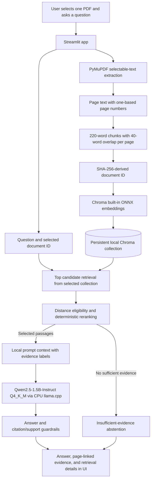

# Application Architecture

The application is a one-paper-at-a-time, local-first RAG prototype. Its Streamlit interface orchestrates text extraction, indexing, retrieval, local generation, and display of evidence with source page numbers.

## Data flow

1. **Upload and extraction:** Streamlit accepts a PDF in memory (maximum 50 MB). PyMuPDF extracts selectable text per page. Empty or unreadable PDFs produce explicit errors. Scanned/image-only documents are not OCR'd.
2. **Chunking:** Each page is split independently into 220-word chunks with a 40-word overlap; chunk metadata retains its original one-based PDF page. Chunks do not intentionally cross page boundaries.
3. **Local embeddings and storage:** A SHA-256-derived document identifier scopes the collection. Chroma's built-in ONNX embedding function creates embeddings and persists vectors/chunks under the configured local `data/chroma` directory. Telemetry is disabled. Initial ONNX model download may require internet; embedding inference and persistence are local.
4. **Retrieval:** Query vectors search only the selected document collection. The app fetches extra candidates, filters by the configurable cosine-distance threshold (direct textual matches have separate handling), and reranks by question-term overlap. Result/RQ passages are prioritized for result-oriented questions. Explicit acronym-definition questions can search local indexed chunks for direct expansions. These ranking rules are heuristics; similarity distance is not a correctness score.
5. **Answer generation:** The selected text is passed to local CPU inference through llama.cpp using Qwen2.5-1.5B-Instruct Q4_K_M. Hosted inference is unsupported. The prompt treats passages as evidence, not instructions; requests claim-linked evidence labels; preserves distinctions among entities, metrics, relations, and conditions; and requires uncertainty rather than guessing when evidence is inadequate.
6. **Checks and display:** Application checks validate citation syntax/labels, claim citations, numeric support, lexical support heuristics, explicit mappings, and prompt context size. A complete, unambiguous mapping can be assembled from directly supporting or adjacent page-boundary passages. The app displays the answer and the selected passages with filename and PDF page numbers. Heuristic checks cannot guarantee semantic entailment: users must inspect the original evidence.

## Components

- `app.py`: Streamlit upload/question interface and result/error display.
- `src/research_analyzer/pdf_processor.py`: page extraction and page-preserving chunks.
- `src/research_analyzer/vector_store.py`: local Chroma persistent store, embeddings, and retrieval.
- `src/research_analyzer/pipeline.py`: document indexing, retrieval, ranking, and orchestration.
- `src/research_analyzer/answering.py`: local llama.cpp model, prompts, answer generation, and evidence checks.
- `experiments/`: separate research dataset verification, experiment runners, and review utilities. The historical pilot experiments use fixed evidence, not the application's live PDF retrieval path.

## Boundaries and prerequisites

No hosted inference or paid API is configured or supported. A fresh setup may require internet for package installation, the pinned GGUF download, and Chroma's initial ONNX embedding model. Once downloaded and installed, inference, embeddings, and document storage are local. The model file and `.env` are not committed.

The app does not implement OCR, semantic entailment proof, multi-paper comparisons, or automated scientific fact verification. A retrieval miss may cause an abstention even if the PDF contains the answer; a small model may still err despite relevant evidence and guardrails.

Setup and execution commands are maintained in the root [README](../README.md).
